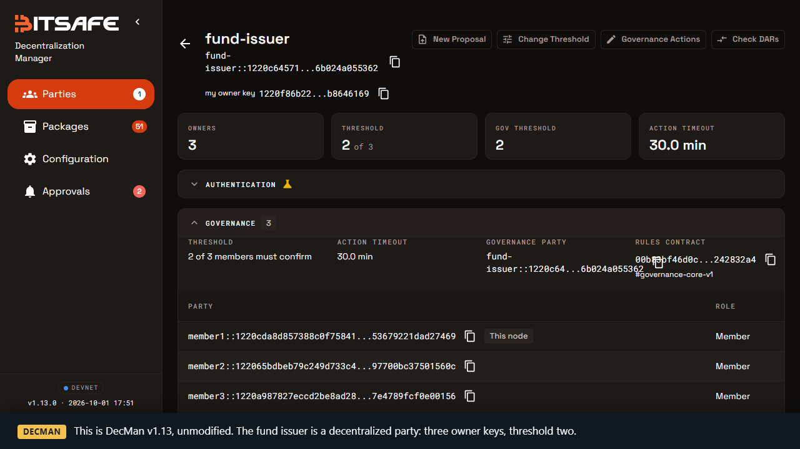
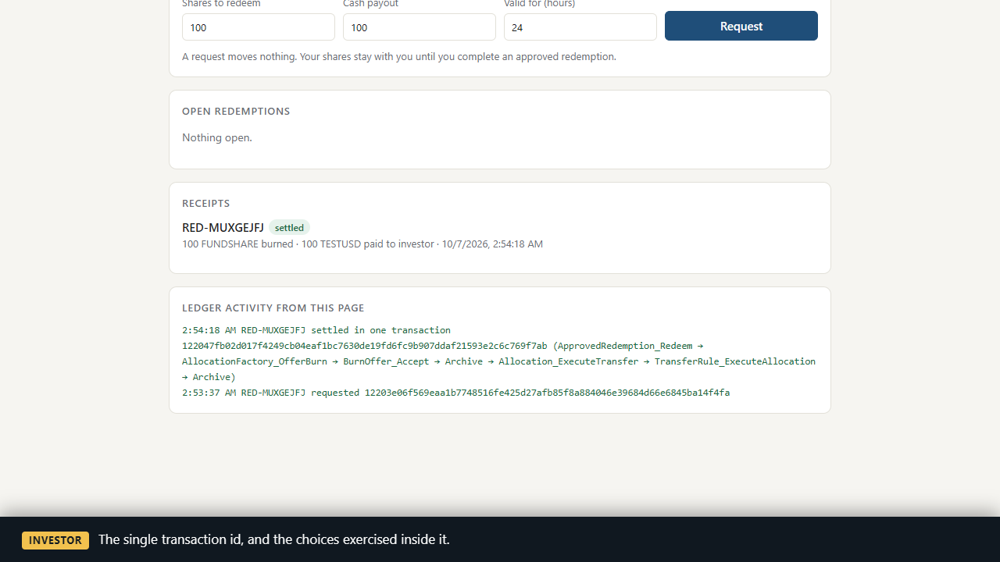

# IntentTA

Private redemption settlement for Canton.

A fund issuer approves and funds one investor's redemption through DecMan governance. The investor then burns the shares and receives the cash in a single transaction. If either leg fails, neither happens.

IntentTA is a Daml package that wires three existing components together and leaves all three unmodified:

- [Decentralization Manager](https://github.com/DLC-link/decentralization-manager) (DecMan) from BitSafe, for the 2-of-3 committee approval
- the DA Registry, for the share burn
- the Canton Token Standard (CIP-0056), for reserving and paying the cash

It is a reusable contract package with a small demo. It is not a fund platform.

## Demo

[`docs/demo/intentta-demo.mp4`](docs/demo/intentta-demo.mp4), under three minutes, recorded on a local Canton network with four participants and three DecMan nodes. It shows DecMan's own UI for the issuer, an investor requesting a redemption from a separate participant, the committee voting through the DecMan nodes, the one-transaction settlement, then a replay, a failed settlement and a cancellation. Nothing is mocked; the transaction ids on screen come from the ledger.

| The issuer in DecMan | Settled in one transaction |
|---|---|
|  |  |

## How it works

```
Investor                     Committee (DecMan, 2 of 3)                  Ledger
   |                                  |
   |-- InvestorIntent --------------->|   signed by the investor; nothing moves
   |                                  |-- ApproveRedemptionAction (proposal)
   |                                  |-- confirm, confirm
   |                                  |-- execute ----------------------> one transaction:
   |                                  |                                    policy limits checked
   |                                  |                                    exact payout reserved
   |                                  |                                    request consumed
   |<---------------- ApprovedRedemption (single use, funded) ------------ approval created
   |
   |-- Redeem ----------------------------------------------------------> one transaction:
   |                                                                       burn offer created, accepted
   |                                                                       reserved cash transferred
   |<---------------- RedemptionReceipt ---------------------------------- receipt created
```

1. **Request.** The investor creates an `InvestorIntent` naming the issuer, the exact share and cash instruments, the quantity, the payout, the recipient and an expiry. The shares stay where they are, and the investor gets no governance rights.
2. **Approve and reserve.** A committee member proposes an `ApproveRedemptionAction`, which is a DecMan custom action. Once two of three members have confirmed, executing it consumes the request, reserves the exact payout as a token-standard allocation and creates a single-use `ApprovedRedemption`, all in one transaction. If the cash cannot be reserved there is no approval.
3. **Settle.** The investor exercises `Redeem`. It creates and accepts the Registry burn offer, executes the reserved transfer and writes the receipt. The shares are never moved to the issuer to be burned later.

The design is described in [docs/ARCHITECTURE.md](docs/ARCHITECTURE.md).

## What has been verified

There are three layers of evidence, each stronger about a different thing.

**Daml Script tests** (36, all passing; list in [evidence/daml-tests.txt](evidence/daml-tests.txt)). These cover the rules: every safeguard in the brief, attacked through direct contract calls. A test that expects a rejection also checks the reason, so it cannot pass by failing for an unrelated cause.

**A single-participant Canton sandbox** ([evidence/local-e2e.md](evidence/local-e2e.md), 7 scenarios). This covers what Daml Script cannot: real transactions through the JSON Ledger API, a cancel and a redeem genuinely in flight at the same time, and each party's transaction history.

**A four-participant network with three DecMan nodes** ([evidence/decman-e2e.md](evidence/decman-e2e.md), 4 scenarios). Here the issuer is a real DecMan decentralized party, with three owner keys and threshold two, hosted on three participants. Each committee member runs their own DecMan v1.13 node, and the investor is on a fourth participant. Every act of the issuer, from becoming a Registry registrar to approving a redemption, is confirmed and executed through the DecMan nodes' REST API.

| Requirement | Shown by |
|---|---|
| 100 FundShare burned for 100 TestUSD | `test_redeem_100_shares_for_100_cash`; sandbox S1; DecMan network D1 |
| Request consumed, payout reserved, approval created together | S1 and D1: `RedemptionPolicy_Reserve`, `AllocationFactory_Allocate` and `InvestorIntent_Approve` under one update id |
| Burn and payout in one transaction | S1 and D1: `AllocationFactory_OfferBurn`, `BurnOffer_Accept`, `Allocation_ExecuteTransfer` and the receipt under one update id |
| Real DecMan 2-of-3 governance | D1: confirmed on DecMan nodes 1 and 2, executed on node 3; execution at one confirmation is refused by DecMan |
| No unfunded approval | `test_unfunded_approval_is_rejected` |
| Failed settlement burns nothing | S2, `test_payout_unavailable_does_not_burn`, `test_failed_burn_does_not_pay_and_retry_succeeds` |
| Cancellation, with cash cleanup tracked separately | S3, D2, `test_cancel_then_redeem` |
| Cancel against redeem | S4: both in flight, six rounds, exactly one commits each time, both outcomes occur |
| Replay | S1, D1, `test_approval_pays_exactly_once` |
| Direct contract calls | `Test/DirectCalls.daml`, S5, D3 |
| Completion without the proposing service | D1: the settlement is submitted from the investor's participant with `actAs: [investor]`; no committee node takes part |
| Privacy | `Test/Privacy.daml`; S7 by transaction history; D4 by comparing what the investor's participant and an issuer-hosting participant hold |
| A consuming example | [examples/consumer-fund](examples/consumer-fund), a separate package built on the kit's DAR |

Each safeguard, its mechanism and its test are listed in [docs/SAFEGUARDS.md](docs/SAFEGUARDS.md). What each party and each node operator can see is in [docs/PRIVACY.md](docs/PRIVACY.md).

## What has not been done

- **DevNet.** There is no DevNet evidence, because access has not been arranged. The DecMan network above is local. [docs/DEVNET.md](docs/DEVNET.md) lists what a DevNet run needs and what is still unknown.
- **The DA Registry's hosted service.** The Registry contracts are the real ones. The off-ledger Registry API, which hands out choice contexts and disclosed contracts, is not public, so the scripts read the same data from the registrar's participant.
- **USDCx.** Only a synthetic TestUSD has been used.
- **Other platforms.** Everything was built and run on Windows 10 with Git Bash. Linux and macOS are untested.
- **Audit.** None.

## Layout

```
daml/
  intentta-redemption/       the kit
  intentta-issuer-setup/     governed setup steps for an issuer that is a decentralized party
  intentta-redemption-test/  Daml Script tests and the sandbox bootstrap
  dars/                      pinned dependencies, with checksums
examples/consumer-fund/      a separate package that uses the kit
demo/                        the investor page and its server
scripts/                     build, test, sandbox, committee CLI, evidence runs
scripts/decman/              the four-participant network and DecMan nodes
docs/                        architecture, safeguards, privacy, DecMan, DevNet
evidence/                    test results and transaction evidence
```

## Running it

You need the Daml SDK 3.4.11, JDK 17, Node.js 20 or newer, and a POSIX shell (Git Bash on Windows). Either have `daml` on your `PATH`, or unpack the SDK tarball from the [Daml releases](https://github.com/digital-asset/daml/releases/tag/v3.4.11) and set `DAML_SDK_DIR` to it and `JAVA_HOME` to the JDK. Only the second route has been exercised.

Build and test:

```bash
sh scripts/build.sh
```

```bash
sh scripts/test.sh
```

### Single-participant sandbox

```bash
sh scripts/localnet.sh start
```

```bash
sh scripts/localnet.sh bootstrap
```

```bash
node scripts/e2e.mjs
```

The bootstrap creates the Registry, a `FUNDSHARE` and a `TESTUSD` instrument under separate admins, a `GovernanceRules` contract with three members and threshold two, the redemption policy and the starting balances. `e2e.mjs` runs the seven scenarios and exits non-zero if any assertion fails.

To try the investor page, start it and open http://localhost:8787:

```bash
node demo/server.mjs
```

Request a redemption on the page, then vote from another terminal, using the request id the page shows:

```bash
node scripts/committee.mjs approve RED-XXXX
```

`committee.mjs` also has `propose`, `confirm` and `execute` as separate steps, and `housekeeping`. Each invocation submits as one member and exits. Stop the sandbox with `sh scripts/localnet.sh stop`.

### DecMan network

This needs Docker as well. It starts a four-participant Canton network and three DecMan nodes, onboards the issuer as a decentralized party, deploys its rules contract, sets up the fund by vote and runs the redemption scenarios. See [docs/DECMAN.md](docs/DECMAN.md).

```bash
sh scripts/decman/up.sh
```

```bash
node scripts/decman/redeem.mjs
```

The DecMan UIs are then at http://localhost:8081, 8082 and 8083. `sh scripts/decman/page.sh` serves the investor page against this network.

## Using the kit

Add the DAR as a data dependency:

```yaml
data-dependencies:
  - intentta-redemption-v1-0.1.0.dar
```

[examples/consumer-fund](examples/consumer-fund) is a fund that redeems at a fixed par value. Its `RedemptionDesk` turns "redeem 80 shares" into a standard `InvestorIntent`; approval, reservation, burn, payout and receipt are the kit's code, unchanged.

## Dependencies

Pinned, vendored in `daml/dars/` and checksummed. Sources and licences are in [NOTICE](NOTICE).

| | Version |
|---|---|
| Daml SDK | 3.4.11, LF target 2.2 |
| DecMan `governance-core-v1`, `governance-action-v1` | 0.1.0 |
| DecMan node (DecMan network only) | v1.13.0 |
| DA Registry `utility-registry-app-v0` | 0.7.0 |
| DA Registry `utility-registry-v0`, `utility-registry-holding-v0` | 0.6.0, 0.2.1 |
| Token Standard `splice-api-token-*-v1` | 1.0.0 |
| Canton (DecMan network only) | the build in Splice 0.6.12, protocol version 35 |

## Security

The repository holds no credentials and the demos need none. Before pushing a clone, turn on the hooks that scan for secrets:

```bash
git config core.hooksPath .githooks
```

Details are in [SECURITY.md](SECURITY.md).

## Licence

Apache 2.0. See [LICENSE](LICENSE) and [NOTICE](NOTICE).
